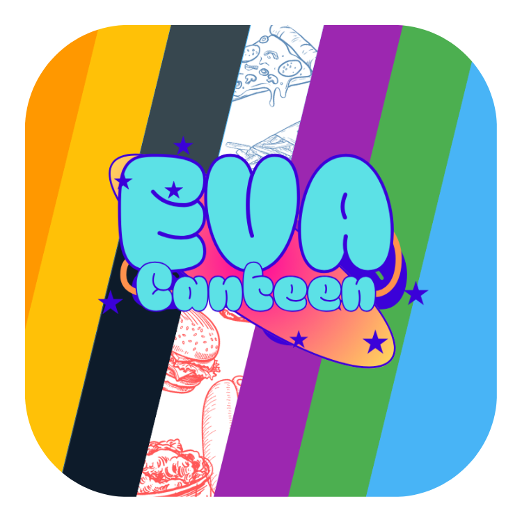
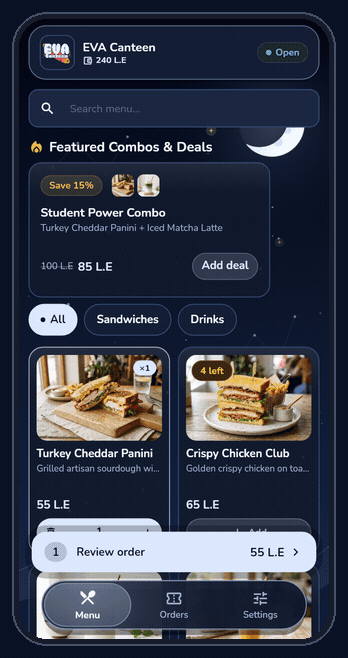
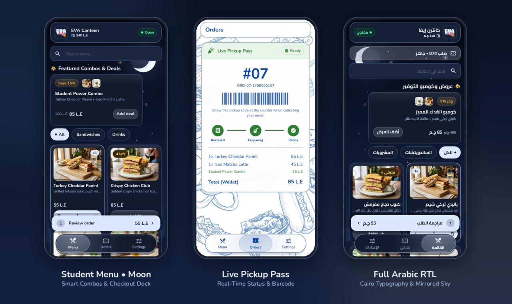
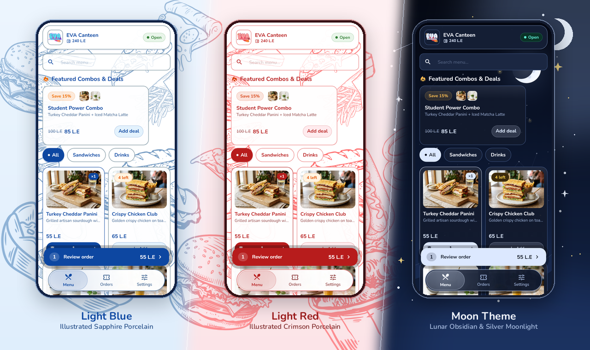
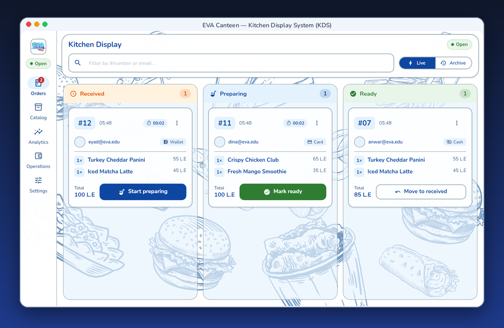
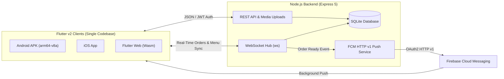

<div align="center">

  

  <h1>EVA Canteen</h1>

  <p>
    <strong>Real-Time Bilingual School Canteen Ordering, Live Pickup Pass & Kitchen Display System</strong>
    <br />
    Cross-platform <strong>Flutter</strong> app (Android, iOS & Wasm Web) powered by <strong>Node.js</strong>, <strong>WebSockets</strong>, <strong>SQLite</strong>, and <strong>Firebase Cloud Messaging</strong>.
  </p>

  <p>
    <a href="#-live-demos">Live Demos</a> •
    <a href="#-student-experience">Student App</a> •
    <a href="#-signature-themes">Themes</a> •
    <a href="#-kitchen-display-system-kds">Admin KDS</a> •
    <a href="#-architecture">Architecture</a> •
    <a href="#-quick-start">Quick Start</a> •
    <a href="#-download-android-apk">Download APK</a>
  </p>

  <p>
    
    
    
    
    
    
    
  </p>

  <p>
    <a href="https://github.com/e6ad2020/EVA_Canteen/raw/refs/heads/apk-builds/EVA-Canteen-arm64-v8a-release.apk">
      
    </a>
  </p>

</div>

---

## 🎬 Live Demos

<div align="center">
  <table>
    <tr>
      <td align="center" width="50%">
        
        <br />
        <strong>Kinetic 3-Layer Splash Screen</strong>
        <br />
        <sub>Orbital swoosh launch, halo ripple, starburst & glossy sheen on the Light Blue default theme (tap to skip).</sub>
      </td>
      <td align="center" width="50%">
        
        <br />
        <strong>Staggered Wave Navigation & Live Themes</strong>
        <br />
        <sub>120fps single-layer GPU category transitions and instant switching across Moon, Light Blue & Light Red.</sub>
      </td>
    </tr>
  </table>
</div>

---

## 📱 Student Experience

<div align="center">
  
</div>

<br />

- **Interactive Menu & Smart Combos:** Browse categorized items with live inventory counts, low-stock badges, automatic percentage-off bundle discounts, and a floating checkout dock that lifts cleanly above the adaptive floating navbar.
- **Live Pickup Pass:** Every order receives a live pickup ticket (`#07`) with a deterministic pickup barcode, animated 3-stage progress stepper (`Received` → `Preparing` → `Ready`), itemized receipt, and one-tap reorder from order history.
- **Background & Foreground Order-Ready Notifications:** Powered by **Firebase Cloud Messaging (HTTP v1)** + `flutter_local_notifications` + live WebSockets. Students receive instant push alerts outside the app when their order is ready at the counter, with deep-linking straight to the pinned Ready ticket and automatic deduplication.
- **Full Bilingual English & Arabic (RTL):** Seamless instant switching between English (`Nunito`) and Arabic (`Cairo`) with RTL-mirrored layouts, localized prices/currency, and mirrored lunar sky artwork.
- **Zero-Reload Image Caching:** Persistent 14-day disk cache + quantized RAM bitmap buckets (`160` / `480` / `960 px`) with immutable HTTP cache headers so menu photos load instantly across tab and category switches.
- **Adaptive Floating Navigation Bar:** Jelly-physics touch pill that dynamically hides tab labels while scrolling (configurable in Settings: *Hide on scroll*, *Always show*, or *Icons only*).

---

## 🎨 Signature Themes

<div align="center">
  
</div>

<br />

EVA Canteen ships with **8 curated themes** across Light and Dark modes — headlined by **3 signature themes** with custom backgrounds and bespoke logo palettes:

| Theme | Aesthetic | Signature Details |
| :--- | :--- | :--- |
| **🌙 Moon (`القمر`)** | Lunar Obsidian & Silver Moonlight | Procedural midnight sky, sculpted RTL-mirrored crescent moon with lunar maria, gossamer constellations, 5 softly twinkling hero stars, silver rim-lit obsidian cards, custom crescent swatch, and a curated **Lunar Mist** daylight fallback. |
| **💙 Light Blue (`أزرق فاتح`)** | Illustrated Sapphire Porcelain | Hand-illustrated food line-art wallpaper, crisp translucent porcelain cards, sapphire accents (`#0D47A1`), and cyan/indigo emblem. |
| **❤️ Light Red (`أحمر فاتح`)** | Illustrated Crimson Porcelain | Crimson illustrated wallpaper, warm rose borders, coral-gold accents (`#B71C1C`), and coral/gold emblem. |
| **Additional Presets** | Light & Dark Modes | **Cobalt**, **Emerald**, **Violet**, **Amber**, and **Monochrome** — each with optional subtle architectural dot backdrop. |

---

## 🖥️ Kitchen Display System (KDS) & Admin Suite

<div align="center">
  
</div>

<br />

- **Live Kanban KDS:** Real-time WebSocket order tickets grouped by `Received`, `Preparing`, and `Ready` with elapsed prep timers, payment badges (`Wallet`, `Card`, `Cash`), search by pickup number/email, and one-tap status progression (automatically triggering student push alerts when marked Ready).
- **Catalog Studio:** Menu-matched 2-column/4-column product grid with 2D drag-and-drop ranking, 1-tap rank nudges, bilingual product/category editors, image uploads, stock controls, and bundle deal management.
- **Operations & Student Wallets:** Open/close the canteen live, toggle accepted payment methods, configure bilingual currency symbols, and top up or audit student wallet balances.
- **Live Sales Analytics:** Interactive `fl_chart` revenue charts, order volume trends, average order value, and top-selling item breakdowns.

---

## 🏗 Architecture



---

## 🛠 Tech Stack

| Layer | Technologies |
| :--- | :--- |
| **Client UI** | Flutter (Dart 3.14+), `material_ui`, Riverpod (`flutter_riverpod`), `go_router`, `fl_chart` |
| **Media & Performance** | `cached_network_image`, `flutter_cache_manager`, quantized RAM `ResizeImage`, zero-`BackdropFilter` GPU compositing |
| **Push Notifications** | `firebase_core`, `firebase_messaging`, `flutter_local_notifications`, Node `firebase-admin` (FCM HTTP v1) |
| **Backend Server** | Node.js (22+), Express 5, `ws` WebSockets, `jsonwebtoken`, `bcrypt` |
| **Storage** | SQLite (`better-sqlite3` with automatic schema migrations & backups) |

---

## 📂 Project Structure

```text
EVA_Canteen/
├── docs/media/                   # README screenshots & animated demo GIFs
├── flutter_app/                  # Flutter v2 cross-platform client (Android, iOS, Wasm Web)
│   ├── android/                  # Android 12+ splash, FCM config & monochrome notification icons
│   ├── ios/                      # iOS LaunchScreen storyboard & app runner
│   ├── web/                      # Wasm-ready web shell & self-cleaning startup splash
│   ├── assets/                   # Layered EVA emblem PNGs, wallpapers, Nunito & Cairo fonts
│   ├── lib/
│   │   ├── core/                 # Models, i18n, WebSocket client, Riverpod state, image cache, FCM
│   │   ├── design_system/        # EvaThemeBuilder, EvaTokens, Moon backdrop & shared widgets
│   │   └── features/             # Splash, Auth, Student Menu/Cart/Orders, Admin KDS/Catalog/Ops/Analytics, Settings
│   └── test/                     # 23 automated unit & widget tests
├── server.js                     # Express 5 HTTP server, REST endpoints & WebSocket broadcast hub
├── database.js                   # SQLite schema, migrations & persistence helpers
├── push_service.js               # Firebase Admin FCM HTTP v1 notification dispatcher
├── db_cli.js                     # Direct SQLite CLI helper
└── render.yaml                   # Render.com production deployment blueprint
```

---

## 🚀 Quick Start

### 1. Run the Backend Server

```bash
git clone https://github.com/e6ad2020/EVA_Canteen.git
cd EVA_Canteen
npm install
npm start
```

The server automatically initializes `data/canteen.db` on first run and starts listening on `http://localhost:8080` (with WebSockets on the same port).

<details>
<summary><strong>Optional: Enable Firebase Push Notifications (FCM HTTP v1)</strong></summary>

1. Place your Firebase Admin service account JSON on the server and set either:
   - `FIREBASE_SERVICE_ACCOUNT_JSON` (raw JSON string or base64-encoded), or
   - `GOOGLE_APPLICATION_CREDENTIALS=/path/to/service-account.json`
2. For Android builds, place your Firebase `google-services.json` in `flutter_app/android/app/google-services.json` (git-ignored).

</details>

### 2. Run or Build the Flutter App

```bash
cd flutter_app
flutter pub get

# Run analyzer & full widget/unit test suite
flutter analyze && flutter test

# Run locally on Chrome / Android / Emulator
flutter run

# Build WebAssembly (Wasm) web bundle
flutter build web --wasm

# Build release Android APK (arm64-v8a)
flutter build apk --release --target-platform android-arm64
```

You can also build and serve the Flutter Wasm frontend directly from the Node.js server:

```bash
npm run start:web-flutter
```

### Default Admin Login (Local Dev)

| Role | Email | Password |
| :--- | :--- | :--- |
| **Admin** | `admin@canteen.app` | `admin123` |

> **Security Tip:** Change the default admin password immediately before deploying to production.

---

## 📲 Download Android APK

Pre-built FCM-enabled `arm64-v8a` release APKs are published on the [`apk-builds`](https://github.com/e6ad2020/EVA_Canteen/tree/apk-builds) branch:

- **Latest Release (`v2.0.0`):** [Download `EVA-Canteen-arm64-v8a-release.apk`](https://github.com/e6ad2020/EVA_Canteen/raw/refs/heads/apk-builds/EVA-Canteen-arm64-v8a-release.apk)

---

## 👥 Team & Credits

Designed & engineered by students at **EVA International Applied Technology School**:

- **Eyad Gaber**
- **Anwar Qasem**
- **Dina Mahmoud**
- **Ahmed Mohamed**

---

## 📄 License

Licensed under the **GNU General Public License v3.0** — see [LICENSE](LICENSE) for details.
